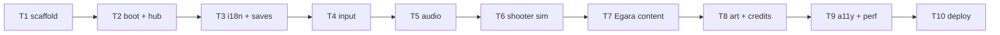

# Plan: Tollywood Arcade v1 — Egara + hub

**Goal**: ship one polished, bilingual, 16×16 pixel arcade game (*Egara*, inspired
by Eega) plus the hub on GitHub Pages, on three reusable cores so games 2–6 are
content packs. Reuse the official MIT Phaser template; no engine is written.

**Architecture**: `src/core` (boot, scale, i18n, save, input, audio, HUD) is
engine-agnostic; `src/engines/shooter` owns the deterministic sim; `src/games/egara`
supplies tuning and rendering. Vite MPA emits `dist/index.html` and
`dist/games/egara/index.html`; `base` is `/tollywood-arcade/`.

**Tech stack**: Node 24.19, npm 11.17, Phaser 4.2.1, Vite, TypeScript 5,
Vitest, Playwright, GitHub Actions Pages. Commands: `npm run build`,
`npx vitest run`, `npx playwright test`.

**Spec**: `docs/specs/2026-10-25-tollywood-arcade.md` (approved 2026-10-25).

**Global constraints**: no UI framework, no backend, no film assets, no
analytics; static output only; English default + Telugu toggle; 16×16 art.

**Lean constraints**: engine = reuse (rung 5), template = fork (rung 2), hub =
plain HTML (rung 3/6), saves = `localStorage` (rung 3), hosting = native Pages
(rung 4). Only the melee core may be custom (rung 7), and it is deferred.

**Review focus**: determinism of the shooter sim, input latency, save
migration, asset licences, bundle/asset budgets, Pages base-path correctness.

## Tasks

| # | Task | Spec req | Files | Test | Expected | Verify |
|---|------|----------|-------|------|----------|--------|
| 1 | Scaffold from `phaserjs/template-vite-ts` (MIT), pin Phaser 4.2.1, strip demo content, add MPA entries + Vitest/Playwright configs | R1, R2, R11 | `package.json`, `vite.config.ts`, `tsconfig.json`, `index.html`, `games/egara/index.html`, `src/games/egara/main.ts` | `npm run build` | `dist/index.html` + `dist/games/egara/index.html`, base `/tollywood-arcade/` | `test -f dist/games/egara/index.html` |
| 2 | Core boot: 960×540 FIT scale, scene switch, pause on blur, DOM overlay mount; hub page with six cards (five locked) and `404.html` | R7, R11 | `src/core/boot.ts`, `src/core/hud.ts`, `index.html`, `404.html` | `tests/smoke/hub.spec.ts` | hub renders 6 cards; Egara canvas mounts; zero console errors | `npx playwright test tests/smoke/hub.spec.ts` |
| 3 | i18n (`en`/`te` dictionaries) + versioned saves (`v1`: lang, muted, best, remaps) with migration and corrupt-data reset | R5, R10 | `src/core/i18n.ts`, `src/core/save.ts`, `tests/unit/i18n.spec.ts`, `tests/unit/save.spec.ts` | unit: toggle persists, v0 migrates, corrupt JSON resets | language survives reload; bad save never throws | `npx vitest run tests/unit/i18n.spec.ts tests/unit/save.spec.ts` |
| 4 | Input layer: action map, keyboard + pointer/touch + gamepad (deadzone), remap storage, pause binding | R9 | `src/core/input.ts`, `tests/unit/input.spec.ts` | unit: remap resolution, deadzone, multi-device merge | one action fires from any device | `npx vitest run tests/unit/input.spec.ts` |
| 5 | Audio: unlock on first gesture, mute toggle persisted, graceful failure when asset missing | R9, R10 | `src/core/audio.ts`, `tests/unit/audio.spec.ts`, `tests/smoke/audio.spec.ts` | unit state + Playwright gesture | no autoplay console error; mute survives reload | `npx playwright test tests/smoke/audio.spec.ts` |
| 6 | Shooter sim: fixed 1/60 step, clamped accumulator, mulberry32 RNG, pooled entities, circle collision, score, state hash | R2, R7, R12 | `src/engines/shooter/sim.ts`, `src/engines/shooter/pool.ts`, `tests/unit/shooter-sim.spec.ts` | same seed + input log → identical hash; pools never grow after warm-up | deterministic replay; p95 sim step < 2 ms | `npx vitest run tests/unit/shooter-sim.spec.ts` |
| 7 | Egara content: fly dodge/sting, 3 enemies (swatter, spray, spider), boss at 60 s, 90 s run, 3 lives, win/lose, score | R3, R4 | `src/games/egara/**`, `public/content/egara/tuning.json`, `tests/unit/egara.spec.ts`, `tests/smoke/egara.spec.ts` | unit: wave schedule ends at 90 s, boss at 60 s, life loss rules; smoke: 5 s headless run | full run reachable; no console errors | `npx vitest run tests/unit/egara.spec.ts` |
| 8 | Art/audio integration from Kenney CC0 + `assets/manifest.json` with licence fields; `CREDITS.md`; asset budget script | R6, R8, R13, R14 | `public/assets/egara/**`, `scripts/check-assets.mjs`, `CREDITS.md` | budget script | every asset ≤5 MB total and has a licence entry | `node scripts/check-assets.mjs` |
| 9 | A11y + perf: ARIA menus, focus trap, reduced-motion, remap UI, Telugu strings complete, adaptive DPR, bundle budget script, perf protocol | R5, R7, R8, R9, R15 | `src/core/hud.ts`, `src/core/a11y.ts`, `scripts/check-budget.mjs`, `docs/qa/perf.md`, `tests/smoke/a11y.spec.ts` | Playwright aria + reduced-motion; budget script | hub ≤60 KB gz, game ≤500 KB gz, aria snapshot passes | `node scripts/check-budget.mjs && npx playwright test tests/smoke/a11y.spec.ts` |
| 10 | Publish: git init, public repo `tollywood-arcade`, Pages workflow, live smoke test | R11, R15 | `.github/workflows/pages.yml`, `README.md` | Playwright against live URL | `https://garikipatisai-code.github.io/tollywood-arcade/` returns 200 and mounts the hub | `npx playwright test tests/smoke/live.spec.ts` |

## Notes

- **T1**: `git clone --depth 1 https://github.com/phaserjs/template-vite-ts /tmp/phaser-tpl`,
  copy config + `src`, delete demo scenes/assets, `npm i phaser@4.2.1`, add
  `vitest`, `@playwright/test`, `typescript`. Do not keep template `.git`.
- **T2**: `Phaser.Scale.FIT` + `CENTER_BOTH`; `visibilitychange` pauses the loop;
  canvas gets `aria-label` and `tabindex="0"`, menus stay in DOM.
- **T6**: inputs are a replay log `{frame, action}`; hash = FNV-1a over positions,
  velocities, hp, score. Never read wall-clock time inside the sim.
- **T7**: tuning lives in JSON so games 2–6 can reuse the engine without code edits.
- **T10**: Pages project sites need `base: '/tollywood-arcade/'`; Actions uses
  `actions/configure-pages`, `upload-pages-artifact`, `deploy-pages` with
  `pages: write` + `id-token: write`.

## Self-review

Coverage: R1–R15 each map to at least one task. No task adds a framework or
backend. Deferred by design: melee core, games 2–6, multiplayer, analytics.
