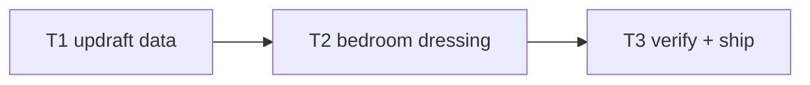

# Plan: ch2 "Rebirth" enrichment

**Goal**: monsoon-night bedroom with updraft flight school and tear-shards,
per the level pattern. No sim changes (wind reuse).

**Global constraints**: no downloads; determinism green; EN/TE untouched.

**Review focus**: headless clear with gusts, no per-frame allocation.

## Tasks

| # | Task | Spec req | Files | Test | Expected | Verify |
|---|------|----------|-------|------|----------|--------|
| 1 | ch2 JSON: 2 updraft zones; extend chapters.spec (updrafts present, clear) | D1 | `chapters/ch2.json`, `tests/unit/chapters.spec.ts` | headless clear | `npx vitest run tests/unit/chapters.spec.ts` |
| 2 | Bedroom: desk/books/cup/lamp/window/locket/rain in world.ts ch2 theme | D2, D3 | `src/render/world.ts` | screenshot shows bedroom | screenshot inspected |
| 3 | Full suite, budgets, smoke, deploy, live, ledger, close | D4 | `docs/qa/perf.md` | all green, live 200 | ship commands |

## Self-review

Coverage: D1–D4 mapped. No sim/story/save/audio changes.
