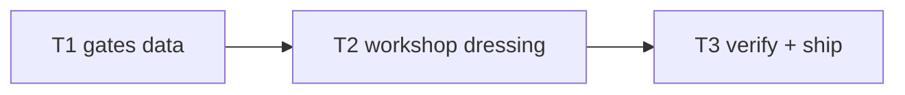

# Plan: ch3 "The Workshop" enrichment

**Goal**: workbench training course with needle-rack landmark, zero sim changes.

## Tasks

| # | Task | Spec req | Files | Test | Expected | Verify |
|---|------|----------|-------|------|----------|--------|
| 1 | ch3 JSON gates + required; extend chapters.spec | E1 | `chapters/ch3.json`, `tests/unit/chapters.spec.ts` | headless clear | `npx vitest run tests/unit/chapters.spec.ts` |
| 2 | Workshop branch in world.ts ch3 theme | E2, E3 | `src/render/world.ts` | screenshot shows bench | screenshot inspected |
| 3 | Full suite, budgets, smoke, deploy, live, ledger, close | E4 | `docs/qa/perf.md` | all green, live 200 | ship commands |

## Self-review

Coverage: E1–E4 mapped. No sim/story/save/audio changes.
