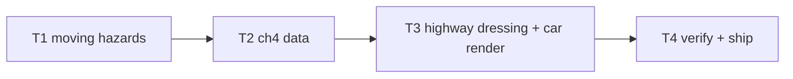

# Plan: ch4 "The First Sting" enrichment

**Goal**: night highway with moving traffic hazards + car rendering.

## Tasks

| # | Task | Spec req | Files | Test | Expected | Verify |
|---|------|----------|-------|------|----------|--------|
| 1 | Hazard velocity + wrap + kind; tests | F1, F2 | `sim.ts`, `tests/unit/level-traffic.spec.ts` | motion, wrap, damage, determinism | `npx vitest run tests/unit/level-traffic.spec.ts` |
| 2 | ch4 JSON cars + content validate; headless clear | F2, F3 | `content.ts`, `ch4.json`, `chapters.spec.ts` | clears with traffic | chapters.spec |
| 3 | Highway theme + car render branch in scene | F4, F5 | `world.ts`, `scenes/EgaraScene.ts` | screenshot shows highway | screenshot inspected |
| 4 | Full suite, budgets, smoke, deploy, live, ledger, close | F6 | `docs/qa/perf.md` | all green, live 200 | ship commands |

## Self-review

Coverage: F1–F6 mapped. No story/save/audio changes.
