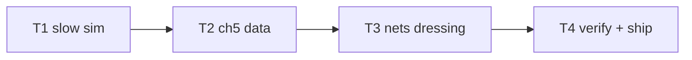

# Plan: ch5 "The Exterminators" enrichment

**Goal**: fume slow zones + extermination dressing.

## Tasks

| # | Task | Spec req | Files | Test | Expected | Verify |
|---|------|----------|-------|------|----------|--------|
| 1 | Slow zones + tests | G1 | `sim.ts`, `tests/unit/level-nets.spec.ts` | factor, stacking, determinism | level-nets.spec |
| 2 | ch5 JSON zones + content/scene plumbing; clear | G2 | `content.ts`, `ch5.json`, `scenes`, `chapters.spec` | clears with fumes | chapters.spec |
| 3 | Nets/coils/vaporizers/placard + decals | G3, G4 | `world.ts`, scenes | screenshot shows siege | screenshot inspected |
| 4 | Full suite, budgets, smoke, deploy, live, ledger, close | G5 | `docs/qa/perf.md` | all green, live 200 | ship commands |

## Self-review

Coverage: G1–G5 mapped. No story/save/audio changes.
