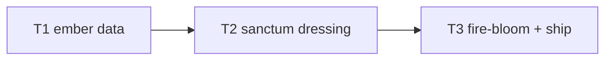

# Plan: ch6 "The Exorcist" enrichment

**Goal**: ritual sanctum dressing + ember shards + fire-bloom escape.

## Tasks

| # | Task | Spec req | Files | Test | Expected | Verify |
|---|------|----------|-------|------|----------|--------|
| 1 | ch6 ember shards; extend boss test | H1 | `ch6.json`, `story-bosses.spec.ts` | escape clears | bosses spec |
| 2 | Kalam/diyas/offerings/silhouette/ash | H2, H4 | `world.ts` | screenshot shows sanctum | screenshot inspected |
| 3 | Fire-bloom on escape; full suite, budgets, smoke, deploy, live, close | H3, H5 | `scenes`, `perf.md` | all green, live 200 | ship commands |

## Self-review

Coverage: H1–H5 mapped. No sim/content/save/audio changes.
