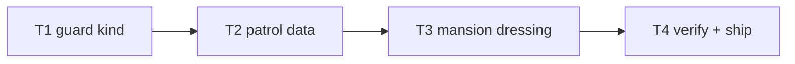

# Plan: ch7 "The Mansion" enrichment

**Goal**: guard patrols + mansion dressing.

## Tasks

| # | Task | Spec req | Files | Test | Expected | Verify |
|---|------|----------|-------|------|----------|--------|
| 1 | `guard` kind type + validate + render branch; traffic tests | I1 | `sim.ts`, `content.ts`, `scenes`, `level-traffic.spec.ts` | guards move/wound | level-traffic.spec |
| 2 | ch7 patrol JSON; headless clear | I2 | `ch7.json`, `chapters.spec.ts` | clears with patrols | chapters.spec |
| 3 | Pillars/chandelier/marble/pooja/CCTV/lawn | I3, I4 | `world.ts` | screenshot shows mansion | screenshot inspected |
| 4 | Full suite, budgets, smoke, deploy, live, ledger, close | I5 | `docs/qa/perf.md` | all green, live 200 | ship commands |

## Self-review

Coverage: I1–I5 mapped. No story/save/audio changes.
