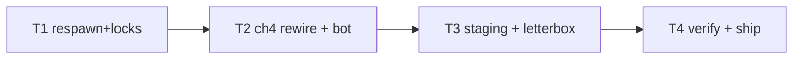

# Plan: Airport Crash Reenactment

**Goal**: ch4 as the crash scene with dart/trace gameplay + cinematic stage.

## Tasks

| # | Task | Spec req | Files | Test | Expected | Verify |
|---|------|----------|-------|------|----------|--------|
| 1 | Respawn counts, lockedBy gates + validation | R1, R2 | `sim.ts`, `content.ts`, `level-crash.spec.ts` | retake cycles, order enforced | crash spec |
| 2 | ch4 JSON (eye, letters, waves); bot wins | R3 | `ch4.json`, `chapters.spec.ts`, `story-bosses.spec.ts` | headless crash+trace+clear | full unit |
| 3 | Hero car, windshield, gates, cinematic, letterbox, numerals | R4, R5 | `world.ts`, `scenes`, `hud.ts`, `index.html` | screenshot shows scene | screenshot inspected |
| 4 | Full suite, budgets, smoke, deploy, live, close | R6 | `perf.md` | all green, live 200 | ship commands |

## Self-review

Coverage: R1–R6 mapped. No save/audio/asset changes. Eye shard is a plain
shard with respawns; letters are required plain shards with locks.
