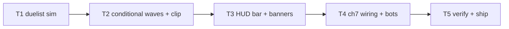

# Plan: Needle Duel Reenactment

**Goal**: playable mansion duel as the reenactment pattern.

## Tasks

| # | Task | Spec req | Files | Test | Expected | Verify |
|---|------|----------|-------|------|----------|--------|
| 1 | Modes, tracking, timers, double damage | N1, N2 | `sim.ts`, `level-duel.spec.ts` | cycle order, punish window | duel spec |
| 2 | Wing-clip, enrage kept, `after` waves | N3, N4 | `sim.ts`, `director.ts`, `content.ts` | clip event/slow, gated spawn | duel spec |
| 3 | Boss bar + banners + intro wiring | N5 | `hud.ts`, `scenes` | bar tracks, banners fire | story smoke |
| 4 | ch7 escort→duel, bot duel tactics, clears | N6 | `ch7.json`, bot specs | headless duel win | full unit |
| 5 | Full suite, budgets, smoke, screenshot, deploy, live, close | N7 | `perf.md` | all green, live 200 | ship commands |

## Self-review

Coverage: N1–N7 mapped. No save/audio/asset changes. Risk: bot duel
survival — windup 40 f telegraph is generous by design.
