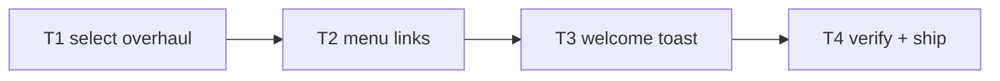

# Plan: Launch Flow + Replay

**Goal**: discoverable story entry, honest locked states, menus that lead home.

**Global constraints**: v1 smoke files untouched and green (instant Sabotage
landing preserved); no save-shape changes; EN/TE.

## Tasks

| # | Task | Spec req | Files | Test | Expected | Verify |
|---|------|----------|-------|------|----------|--------|
| 1 | Locked dim+🔒, Quick-Play card, goal lines | L2 | `hud.ts`, `scenes` | select shows states | story smoke |
| 2 | Chapters link in all menus, drop Story link | L3, L4 | `hud.ts`, `i18n.ts`, `scenes` | pause menu links select | story smoke |
| 3 | Welcome toast on fresh saves | L1, L4 | `hud.ts`, `scenes` | toast shows, CTA works | story smoke |
| 4 | Full suite, budgets, smoke, deploy, live, close | L5 | `perf.md` | all green, live 200 | ship commands |

## Self-review

Coverage: L1–L5 mapped. No sim/content/save/audio changes.
