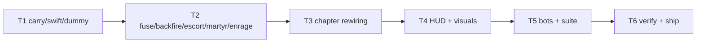

# Plan: Screenplay Gameplay

**Goal**: eight distinct chapter verbs on the deterministic sim; completion
predicates unchanged; HUD narrates objectives.

## Tasks

| # | Task | Spec req | Files | Test | Expected | Verify |
|---|------|----------|-------|------|----------|--------|
| 1 | Carry/dropoff, swiftness, harmless | K1–K3 | `sim.ts`, `level-verbs1.spec.ts` | carry/deliver/drop, swift cap, dummy safety | verbs1 spec |
| 2 | Fuse, backfire, escort/exit, martyr, enrage, marked | K3–K7 | `sim.ts`, `director.ts`, `level-verbs2.spec.ts` | countdowns, burns, follows, blast, rage | verbs2 spec |
| 3 | All 8 chapter JSONs rewired + schema | K8 | `content.ts`, `chapters/*.json` | all validate | chapters.spec |
| 4 | Objective line, banners, carried visuals, markers | K9 | `hud.ts`, `scenes` | e2e sees objectives | story smoke |
| 5 | Bots per verb; every chapter clears headless | K8 | `chapters.spec.ts`, `story-bosses.spec.ts` | 8/8 clear | full unit |
| 6 | Full suite, budgets, smoke, deploy, live, close | K10 | `perf.md` | all green, live 200 | ship commands |

## Self-review

Coverage: K1–K10 mapped. No save/audio/asset changes. Biggest risk: bot
complexity — kept dumb (seek-top-priority state machines).
