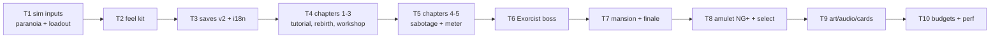

# Plan: Egara v2 — Story Mode (8 chapters)

**Goal**: ship all 8 story chapters on the approved design: data-driven chapters
on the untouched v1 sim (+2 inputs), paranoia meter, 12 shards, linear workshop
unlocks, Exorcist boss, 3-phase finale, amulet NG+, feel kit, silent-film cards.

**Architecture**: `src/games/egara/chapters/*.json` carry waves, paranoia
curves, shards, unlocks. Sim core reused; only `paranoia`/`loadout` inputs and
event emits added. Saves `v1→v2` migration. No backend, no monetization.

**Tech stack**: Node 24, Phaser 4.2.1, Vite, TS 5, Vitest, Playwright.
Commands: `npm run build`, `npx vitest run`, `npx playwright test`,
`npm run assets`, `npm run budget`.

**Spec**: `docs/specs/2026-10-26-egara-story-mode.md` (approved 2026-10-26).

**Global constraints**: original names Gali/Shilpi/Garva; no film assets;
EN+TE; 16×16 art; static output.

**Lean constraints**: chapters = data (rung 7); sim reuse (rung 2); meter = one
number (rung 7); unlocks linear (rung 6); cards = DOM (rung 3).

**Review focus**: chapter JSON schema validity, sim determinism preserved,
migration safety, budget adherence, base-path correctness.

## Tasks

| # | Task | Spec req | Files | Test | Expected | Verify |
|---|------|----------|-------|------|----------|--------|
| 1 | Sim inputs: `paranoia` scales spawn interval/mix, `loadout` gates needle/armor/cannon; emit `shard`/`objective` events; determinism hash unchanged for same inputs | S2, S3 | `src/engines/shooter/sim.ts`, `tests/unit/story-sim.spec.ts` | same seed+log → identical hash; paranoia 100 spawns ≥2× rate of 0 | `npx vitest run tests/unit/story-sim.spec.ts` |
| 2 | Feel kit: shake, hit-stop, knockback, pickup magnet, slow-mo dodge, adaptive buzz layer by meter | S10 | `src/core/feel.ts`, `src/games/egara/scenes/*` | headless frame-step: shake decays, hit-stop freezes sim N frames | `npx vitest run tests/unit/story-feel.spec.ts` |
| 3 | Saves v2 + strings: migrate v1 (keep best/lang/mute/remaps), add chapters/shards/unlocks/amulet; EN/TE cards, chapter names, objectives | S9, S11 | `src/core/save.ts`, `src/core/i18n.ts`, `tests/unit/story-save.spec.ts` | v1 fixture migrates; corrupt v2 resets; TE key parity | `npx vitest run tests/unit/story-save.spec.ts` |
| 4 | Chapters 1-3: courier tutorial (no enemies), Rebirth (flight + 4 shards), Workshop (needle unlock); title cards + pictograms | S1, S4, S5, S11 | `src/games/egara/chapters/*.json`, `tests/unit/chapters.spec.ts` | schema validates; full ch.1-3 headless run, unlock flags set | `npx vitest run tests/unit/chapters.spec.ts` |
| 5 | Chapters 4-5: sabotage stealth + meter debut, exterminators/nets; meter visibly raises spawns + buzz | S1, S3, S10 | `src/games/egara/chapters/*.json` | meter curve test; headless clear of ch.5 | `npx vitest run tests/unit/chapters.spec.ts` |
| 6 | Boss 1 Exorcist (ch.6): ritual-ring hazards, escape sequence, defeat grants armor | S1, S6 | `src/games/egara/chapters/boss-exorcist.json`, scene hook | rings damage on contact; escape timer ends fight | `npx vitest run tests/unit/story-bosses.spec.ts` |
| 7 | Mansion (ch.7) + finale (ch.8): rescue objective, needle duel → wounded flight → cannon one-shot; epilogue grants amulet | S1, S7, S8 | chapters JSON + scene hook | finale phases advance in order; amulet set post-win | `npx vitest run tests/unit/story-bosses.spec.ts` |
| 8 | Chapter select + NG+: DOM cards with lock/score, resume, amulet +1 shard slot effect | S8, S11 | `src/core/hud.ts`, `index.html` (hub card), `tests/smoke/story.spec.ts` | locked chapters unclickable; NG+ shard cap +1 | `npx playwright test tests/smoke/story.spec.ts` |
| 9 | Art/audio/cards: extend 16×16 sheet (Gali/Shilpi/Garva, rings, cannon, shards), palette per chapter, buzz layers, manifest + CREDITS | S4, S11, S12 | `scripts/generate-assets.mjs`, `public/assets/**` | asset gate passes; every file licensed | `npm run assets` |
| 10 | Ship gate: budgets, full suite, device perf row in `docs/qa/perf.md`, live smoke | S12 | `docs/qa/perf.md` | hub ≤60 KB, game ≤500 KB gz; live 200s | `npm run budget && npx playwright test tests/smoke/` |

## Self-review

Coverage: S1–S12 each map to ≥1 task. No framework, backend, economy, or film
asset added. Deferred: games 2–6, multiplayer, analytics.
