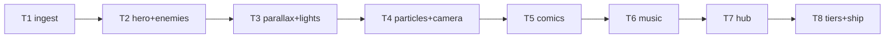

# Plan: Egara Visual Overhaul (v3)

**Goal**: transform Egara from programmer-art to premium 2D. CC0 worlds +
hand hero + lights/particles/parallax + comic cutscenes + generative music +
living hub. Sim, story data, saves untouched.

**Architecture**: `src/art/` vendored packs + audit; `src/render/` parallax,
lights, particles, quality; `src/core/music.ts` generative sequencer;
`cutscenes/*.json` panel data; scene render layer rewritten onto new assets.

**Tech stack**: Node 24, Phaser 4.2.1, Vite, TS, Vitest, Playwright. `npm run
build`, `npx vitest run`, `npx playwright test`, `npm run assets/budget`.

**Spec**: `docs/specs/2026-10-26-egara-visuals.md` (approved, blanket auth).

**Global constraints**: CC0-only vendor art; Gali original; EN+TE; static
output; no film IP; sim untouched.

**Lean constraints**: worlds = packs (rung 2); hero = minimal sheet (rung 7);
FX = native Phaser (rung 4/5); comics = DOM (rung 3); music = code (rung 6).

**Review focus**: license audit completeness, mobile perf, bundle budgets,
no sim behavior change (determinism suite must stay green).

## Tasks

| # | Task | Spec req | Files | Test | Expected | Verify |
|---|------|----------|-------|------|----------|--------|
| 1 | Ingest: copy selected Kenney PNGs + font to `public/assets/vendor`, license audit in manifest, atlas notes | V1 | `src/art/**`, `public/assets/**`, `scripts/check-assets.mjs` | asset gate | all files licensed, ≤15 MB | `npm run assets` |
| 2 | Hero + enemies: detailed 24px Gali anims (hover/dash/hurt/win) + redrawn 5 enemy frames, generator script, same indices | V2 | `scripts/generate-assets.mjs`, `public/assets/egara/sprites.png` | sprite PNG decodes, 8+ frames present | hero reads at 2× zoom | `npm run assets` + visual |
| 3 | Parallax + lights: 3-layer world per chapter tint, gradient sky, torch/glow light rig | V3, V4 | `src/render/world.ts`, scenes | headless render smoke (no errors) | depth + mood per chapter | `npx playwright test tests/smoke/visual.spec.ts` |
| 4 | Particles + camera: dust/embers/trails/sparks library, hit flashes, follow-lerp + zoom punches, vignette/grade | V4, V5 | `src/render/fx.ts`, scenes | unit: emitter budgets respected | juice on every kill/hit | visual.spec.ts |
| 5 | Comics: 8 openers + finale panels (DOM + pack art, EN/TE strings) shown before chapters | V6 | `src/games/egara/cutscenes/**`, `src/core/i18n.ts`, `src/core/hud.ts` | unit: panel schema valid; e2e: opener shows | story reads like film | visual.spec.ts |
| 6 | Music: generative sequencer, per-chapter mood, SFX+ pack, mute persists | V7 | `src/core/music.ts`, `src/core/audio.ts` | unit: deterministic note stream | adaptive beds, no autoplay errors | `npx vitest run tests/unit/visual-music.spec.ts` |
| 7 | Living hub: animated hero, ember canvas, story progress from saves | V8 | `src/hub.ts`, `src/styles/hub.css`, `index.html` | e2e: hub animates, progress shows | hub feels alive | visual.spec.ts |
| 8 | Tiers + ship: auto/manual quality, budgets, perf doc, deploy, live smoke | V9, V10 | `src/core/quality.ts`, scenes, `docs/qa/perf.md` | budgets pass, live 200s | 60 fps target, ship green | `npm run budget` + live |

## Self-review

Coverage: V1–V10 mapped. No sim/story/save edits. Deferred: games 2–6.
