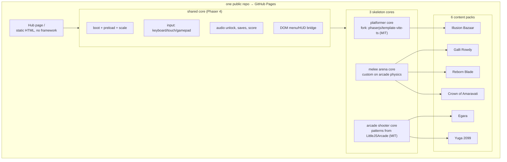

# Tollywood Arcade — Design

Status: draft for approval · 2026-10-25

## Goal

Six small 2D browser games inspired by Telugu cinema eras (1957 → 2024), sharing
three reusable cores, shipped as one static hub on GitHub Pages. Reuse existing
open-source skeletons and CC0 art instead of writing engines or assets.

## Requirements

| ID | Requirement |
|---|---|
| R1 | Reuse only MIT/Apache/CC0 skeletons and assets. No decompiled proprietary code. |
| R2 | Three shared cores: platformer (fork MIT template), melee (custom on Phaser), shooter (LittleJS patterns). |
| R3 | Six games mapped to eras 1957→2024; v1 ships Egara plus the hub. |
| R4 | Egara is complete: 90-second run, 3 enemy types, boss, score, 3 lives, win/lose screens. |
| R5 | English default with a Telugu toggle across hub and game UI. |
| R6 | 16×16 pixel art from CC0/OFL sources only. |
| R7 | Fixed-step 60 Hz simulation, interpolated render, 60 fps on mid-tier hardware. |
| R8 | Per game: JS ≤500 KB gzip (Phaser included), assets ≤5 MB; hub route ≤60 KB gzip; site ≤1 GB. |
| R9 | Keyboard, touch and gamepad input; remappable keys; ARIA menus; motion-reduce. |
| R10 | Versioned `localStorage` saves: language, mute, best score, remaps. |
| R11 | GitHub Pages static multi-page build; per-game `index.html`; Actions deploy. |
| R12 | Vitest for sim/score/save logic; Playwright smoke for every page. |
| R13 | No film stills, songs, posters or likenesses; original titles and art. |
| R14 | `CREDITS.md` and in-app credits list every asset and licence. |
| R15 | First gameplay < 20 s on throttled 4G; LCP ≤2.5 s, INP ≤200 ms, CLS ≤0.1. |

## Non-goals (v1)

- No multiplayer, no backend, no accounts, no analytics, no ads, no monetization.
- No film stills, posters, actor likenesses, songs or official logos.
- No 3D, no mobile app wrappers, no Godot/Unity.
- No game editor or user-generated levels.

## Decision: legal reuse

| Option | Verdict |
|---|---|
| Decompile/recompile commercial games | **Rejected.** Copyright infringement on code, art and audio; unshippable. |
| Fork MIT/Apache open-source games and reskin | **Chosen.** Same speed, publishable, attributable. |
| Build every game from scratch | Rejected. Slower with no quality gain. |
| One engine for all six games | Rejected. Three cores fit the genres with less per-game work. |

Film IP: original titles, original art, no film audio. "Inspired by" only.

## Architecture



Vite multi-page build: each game is its own `games/<slug>/index.html` entry, so
GitHub Pages needs no SPA rewrites and each page loads only its own chunk.

```text
src/core/        boot, input, audio, saves, score, DOM HUD
src/engines/     platformer/, melee/, shooter/
src/games/<slug>/ scene + tuning + content JSON
games/<slug>/index.html
public/assets/<slug>/  sprites, tiles, sfx, music
tests/           Vitest sim tests, Playwright smoke
```

## Game slate

| # | Working title | Inspired by | Genre | Core verb | Core | Art base |
|---|---|---|---|---|---|---|
| 1 | Illusion Bazaar | Mayabazar (1957) | puzzle-platformer | swap / levitate | E1 | Kenney pixel pack |
| 2 | Galli Rowdy | Shiva (1989) | beat-'em-up | punch / throw | E2 | Kenney + itch CC0 urban |
| 3 | Reborn Blade | Magadheera (2009) | hack-and-slash | dash-slash | E2 | Kenney + OGA CC0 |
| 4 | Crown of Amaravati | Baahubali (2015) | side-scroll brawler | block / strike | E2 | Kenney + OGA CC0 |
| 5 | Egara | Eega (2012) | arcade flyer | dodge / sting | E3 | Kenney shmup |
| 6 | Yuga 2099 | Kalki 2898 AD (2024) | top-down shooter | shoot / dash | E3 | itch CC0 cyberpunk |

Ship order: **Egara (vertical slice) → Galli Rowdy → Illusion Bazaar → rest.**
Egara is smallest, proves loop/perf/hosting, and reuses E3 for Yuga 2099.

## Stack

- Phaser **4.2.1** (MIT), TypeScript, Vite. Base skeleton forked from
  `phaserjs/template-vite-ts` (MIT); its pin of 4.0.0 is bumped and smoke-tested.
- No UI framework. Hub is hand-written HTML/CSS (lean rung 3/6).
- Saves: `localStorage`, versioned schema (`ta.save.v1`). No IndexedDB.
- Audio: Phaser audio, unlocked on first gesture.
- Fonts: Noto Sans Telugu + one display face (OFL 1.1), self-hosted subset.
- Assets: Kenney CC0, OpenGameArt CC0/CC-BY only, Freesound CC0,
  Incompetech CC-BY with credit in `CREDITS.md`. Never GPL/NC/ND art.
- Tests: Vitest (sim maths, scoring, save migration), Playwright smoke
  (page loads, canvas present, zero console errors).

## Performance and ship gates

- Fixed-step sim (60 Hz) + interpolated render; no physics tied to refresh.
- 60 fps sustained on a mid-tier Android and a 4 GB Chromebook.
- First gameplay < 20 s on throttled 4G; LCP ≤ 2.5 s, INP ≤ 200 ms, CLS ≤ 0.1.
- Per-game JS ≤ 500 KB gzip (Phaser included); hub route ≤ 60 KB gzip;
  per-game assets ≤ 5 MB; site ≤ 1 GB.
- Keyboard + touch + gamepad, remappable keys, motion-reduce, pause on blur.
- DOM/ARIA menus outside the canvas; no colour-only cues.

## Hosting

GitHub Pages, per user choice. Constraints applied by design:

- Public repo required on the free plan; no commercial use.
- 1 GB site, 100 MB per file, 100 GB/month soft bandwidth.
- No rewrites → per-game `index.html` paths, root hub, `404.html` fallback page.
- Deploy via official `actions/deploy-pages` on push to `main`.
- Fallback if the repo must go private, assets exceed caps, or the site is
  monetized: Cloudflare Pages (private repo, 25 MiB/file, unlimited static
  bandwidth). itch.io is a distribution mirror, not the hub.

## Lean check

| Part | Rung | Why |
|---|---|---|
| Engine, renderer, physics | 5 | Phaser exists; never write one |
| Base template | 2 | Fork the official MIT template |
| Melee core | 7 | No maintained MIT brawler skeleton exists; minimal custom |
| Hub page | 3/6 | Static HTML, no framework, no router |
| Saves | 3 | `localStorage`, not IndexedDB |
| Hosting | 4 | Native platform feature |

## Risks

1. Phaser 4 is young (4.0 Apr 2026) — pin 4.2.1, smoke-test, keep 3.90 as fallback.
2. No MIT brawler skeleton → E2 is the largest build item; prove it with one game.
3. GitHub Pages forbids commercial use and SPA rewrites → static MPA, no ads.
4. Film IP → original names/art/audio; no stills or songs.

## Decisions (approved 2026-10-25)

1. UI language: **English-first with a Telugu toggle** (Noto Sans Telugu).
2. Art direction: **16×16 pixel art**, Kenney CC0 base.
3. V1 depth: **one polished game (Egara) + hub**, then one game at a time.
4. Repo: `tollywood-arcade`, published under the authenticated `gh` account.
