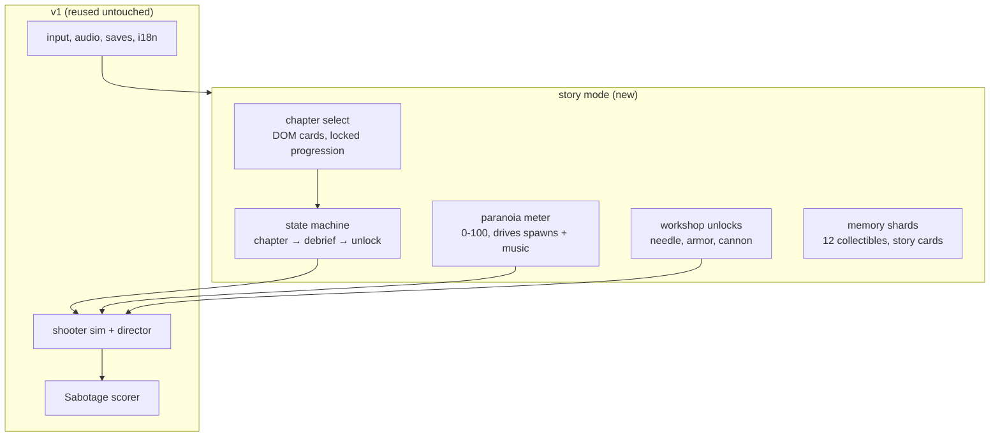

# Egara v2 — Story Mode Design (APPROVED 2026-10-26)

Date: 2026-10-26 · Status: approved — handoff to writing-plans.
Parent spec: docs/specs/2026-10-25-tollywood-arcade.md (v1 gate closed).
Research: docs/research/2026-10-26-eega.md

## 1. Goal

Turn Egara from a 90-second scorer into an 8-chapter story game that delivers
the best player experience on the same static, no-backend, no-monetization
footprint: 30-second verb fun first, then escalation, then a finale worth
replaying. The current Sabotage scorer is kept as a side mode, not replaced.

## 2. Non-goals

- No monetization, ads, accounts, backend, analytics, or multiplayer — ever.
- No film IP ships: original names (finalized §7), art, audio.
- No engine change: Phaser 4.2.1, same sim core, same budgets
  (game ≤500 KB gz, assets ≤5 MB, 60 fps mid-tier).
- No full currency economy in v2: workshop unlocks are linear rewards.

## 3. Alternatives considered

| Option | Verdict |
|---|---|
| Endless scorer + skins only | Rejected. No arc, no S-tier experience. |
| Full open-world hub | Rejected. Scope explosion on a static site. |
| 8 linear chapters + Sabotage side mode | **Chosen.** Film gives the spine; scorer keeps replayability. |
| Currency/shop economy | Rejected for v2. Linear unlocks; revisit only if chapters feel thin. |
| Voice acting / cutscene video | Rejected. Silent-film cards + buzz score fit the fly (no voice, like the film). |

## 4. Architecture

Interfaces: chapters are data (`src/games/egara/chapters/*.json`: waves,
paranoia curve, shard positions, unlock grants). The sim gains two inputs —
`paranoia` level and `loadout` flags — and emits `shardPickup` / `objective`
events. Saves extend to `v2`: chapter progress, shards, unlocks, amulet
(migration from v1 preserves best/lang/mute/remaps).

Chapter list (film beats → levels): 1 Ordinary Skies (courier tutorial, no
enemies) · 2 Rebirth (flight + 4 shards) · 3 The Workshop (needle unlock) ·
4 Sabotage I (stealth, meter debuts) · 5 Sabotage II (exterminators, nets) ·
6 The Exorcist (boss 1: ritual rings + escape) · 7 The Mansion (rescue
infiltration) · 8 The Cannon Run (needle duel → wounded flight → one-shot
sacrifice finale) + epilogue amulet (NG+ charm: start with +1 shard slot).

## 5. Experience pillars (what "best experience" means here)

1. **Feel first:** screen shake, hit-stop, knockback, pickup magnet, slow-mo
   dodge window, adaptive buzz tied to the paranoia meter.
2. **Readable at 16×16:** big-eyed hero, silhouette-distinct enemies,
   non-color cues (shape + motion) for every hazard.
3. **Zero friction:** first gameplay <20 s, auto-save per chapter, resume card
   on the hub, pause on blur, full keyboard/touch/gamepad + remaps.
4. **Silent-film storytelling:** title cards + pictogram objectives, EN/TE —
   no voice, no video, no downloads.
5. **Replay:** chapter select with scores, Sabotage side mode, amulet NG+.

## 6. Lean check

| Part | Rung | Why |
|---|---|---|
| Sim, director, cores | 2 | reuse v1 untouched; two new inputs only |
| Chapters | 7 | data JSON, not code — minimum that works |
| Paranoia meter | 7 | one number modulating existing spawn tables |
| Workshop | 6 | linear unlock flags, no shop UI/economy |
| Story cards | 3 | DOM text, no cutscene system |
| Art | 2 | extend current sheet; palette-swap per chapter |

## 8. Requirements

| ID | Requirement |
|----|---|
| S1 | 8 story chapters ship as data JSON; no chapter logic in code. |
| S2 | Sim accepts `paranoia` (0-100) and `loadout` flags; emits shard/objective events. |
| S3 | Paranoia meter drives spawn rate, enemy mix and music intensity. |
| S4 | 12 memory shards across chapters; pickup persists; story cards in EN/TE. |
| S5 | Workshop grants needle (ch.3), armor (ch.5), cannon (ch.8) linearly. |
| S6 | Boss 1 Exorcist (ch.6): ritual-ring hazards + escape sequence. |
| S7 | Final boss (ch.8): needle duel → wounded flight → one-shot cannon sacrifice. |
| S8 | Wing amulet NG+: +1 shard slot on replay; chapter select with scores. |
| S9 | Saves migrate v1→v2; chapter progress, shards, unlocks persist. |
| S10 | Feel kit: shake, hit-stop, knockback, magnet, slow-mo dodge, adaptive buzz. |
| S11 | Silent-film title cards + pictogram objectives, EN/TE, ARIA menus. |
| S12 | Same budgets: game ≤500 KB gz, assets ≤5 MB, 60 fps, first play <20 s. |

## 7. Decisions (approved 2026-10-26)

1. Names: **Gali** (fly), **Shilpi** (maker-ally), **Garva** (magnate).
2. Chapter order: Exorcist stays boss 1 at ch.6 (midpoint reversal, matches film).
3. Amulet NG+ effect: **+1 shard slot** (no score multiplier — protects balance).
4. Device perf re-run before ship, per docs/qa/perf.md — agreed.
5. Monetization: out of scope permanently; experience-first.
