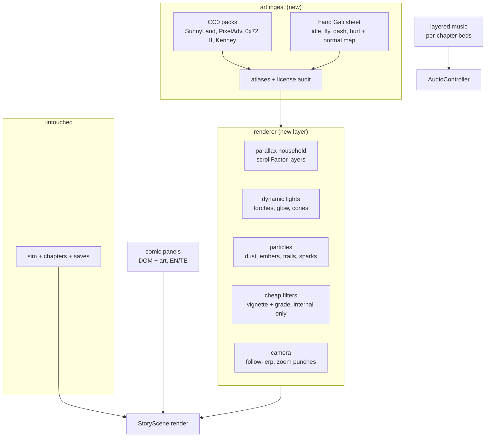

# Egara Visual Overhaul Design (APPROVED 2026-10-26 — blanket authorization)

Date: 2026-10-26 · Status: approved by owner with amendments below.
Owner directives: use any art source incl. AI art; budget unconstrained;
highest quality; proceed end-to-end without pausing for inputs.
Constraint recorded: this environment has no image-generation tool, so AI art
is substituted with pro CC0 packs + hand-authored art + code-driven FX.
Amendment: §2 "No AI-generated art" is STRUCK. All other non-goals stand.
Parents: docs/specs/2026-10-26-egara-story-mode.md (v2 gate closed).
Research: CC0 shortlist (SunnyLand + Pixel Adventure kits, 0x72 II, Kenney
filler, LuizMelo monsters; Szadiart/LPC rejected — not CC0), Phaser 4 FX map
(WebGL RenderNode, dynamic lights + normal maps, particle emitters, Filters
post-FX, Spine first-class, parallax via scrollFactor).

## 1. Goal

Take Egara from programmer-art to genuinely beautiful 2D: hand-animated hero,
curated CC0 worlds, dynamic light, particles, comic cutscenes, layered music —
while the sim, story data, saves, and static hosting stay exactly as they are.
Egara chapters first; hub second. Budgets relaxed per owner: game ≤1.5 MB gz,
assets ≤15 MB, 60 fps via adaptive quality tiers (not raw power).

## 2. Non-goals

- No engine change, no 3D, no Unity/Godot (kills static hosting).
- No sim/story/save changes — pure presentation layer.
- No AI-generated art (license murk, style drift). No film IP. No monetization.
- No fullscreen blur/bloom on mobile (Phaser 4 Filters cost is per-object).

## 3. Alternatives considered

| Option | Verdict |
|---|---|
| All hand-crafted art | Rejected. Months of sprite work for one game. |
| All curated CC0 | Rejected. Hero would look generic; Gali must be original. |
| **Hybrid (chosen)** | Hand-animated Gali + CC0 worlds + Kenney filler + code-driven FX. |
| AI-generated art | Rejected. License murk + style drift across chapters. |
| Engine swap for looks | Rejected. Destroys hosting, budgets, and the working sim. |
| Keep current look | Rejected by owner. |

## 4. Architecture

Interfaces: `src/art/` (audited packs + atlas script + manifest entries);
`src/render/` (parallax builder, light rig, particle library, quality tiers);
`src/games/egara/cutscenes/*.json` (panel lists referencing art + strings);
renderer reads sim state only, never writes it. Quality tiers: high / medium /
low selected by fps sampling + deviceMemory, adjustable in pause menu.

## 5. Pillar tasks (preview — full plan comes from writing-plans)

1. Art ingest + license audit + atlas build.
2. Hand-animated Gali (4 anims) + normal map + wing-trail particles.
3. Parallax household per chapter + torch/glow light rigs.
4. Particle library + hit flashes + camera punches.
5. 8 comic openers + finale (DOM panels, EN/TE).
6. Layered per-chapter music + richer SFX.
7. Living hub (animated hero, ember canvas, progress).
8. Adaptive quality tiers + perf re-run.

## 6. Lean check

| Part | Rung | Why |
|---|---|---|
| Worlds, tiles, props | 2 | CC0 packs exist; never draw a tileset |
| Hero | 7 | Gali must be original; smallest sheet that reads |
| Lights/particles/camera | 4/5 | native Phaser features, not custom shaders |
| Cutscenes | 3 | DOM + static art, no video/cinematic system |
| Music | 5/6 | layered synth beds; CC0 tracks only if they fit |
| Quality tiers | 7 | only as much code as mid-tier 60 fps needs |

## 8. Requirements

| ID | Requirement |
|----|---|
| V1 | Vendor CC0 art ingested with per-file license manifest; total assets ≤15 MB. |
| V2 | Hand-animated Gali sheet (hover/dash/hurt/win) + redrawn enemy sheet; same frame indices. |
| V3 | Parallax 3-layer household world per chapter with tints; gradient skies. |
| V4 | Dynamic lights (torches/glow) + particle library (dust/embers/trails/sparks). |
| V5 | Camera follow-lerp + zoom punches; vignette + grade filters (internal only). |
| V6 | Comic opener per chapter + finale (DOM panels, pack art, EN/TE). |
| V7 | Generative per-chapter music + richer SFX; mute persists. |
| V8 | Living hub: animated hero, ember canvas, story progress. |
| V9 | Quality tiers (auto fps + manual toggle); 60 fps high-tier target on mid-tier. |
| V10 | Budgets: game ≤1.5 MB gz, assets ≤15 MB; live deploy green. |

## 7. Open questions

1. Music: generated synth beds (original, cohesive) vs curated CC0 tracks?
2. Comic art: recolored pack art + hand ink, or fully hand-drawn panels?
3. Default quality tier: start high and degrade, or start medium and upgrade?
4. Hub living page in this overhaul or separate follow-up?
